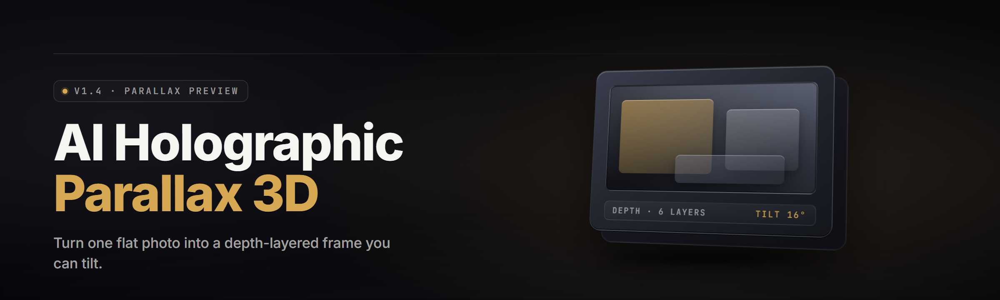

  
  
  

  

  
  

---

Turn any flat photo into a living parallax depth field. `hologram-parallax-photo-studio` runs an on-device depth net, reconstructs a dense point cloud, and renders it back as a wobbling hologram you can stare at for hours. Drop a JPG in, walk out with a 3D you can move your head around.

---

## 🗺 Table of Contents

- [Overview](#overview)
- [What is Hologram Parallax Photo Studio](#what-is-hologram-parallax-photo-studio)
- [Key Features](#key-features)
- [The Problem](#the-problem)
- [The Solution](#the-solution)
- [Quick Start](#quick-start)
- [Module Status](#module-status)
- [Depth & Parallax Feature Categories](#depth--parallaxfeature-categories)
- [Comparison](#comparison)
- [System Requirements](#system-requirements)
- [Installation](#installation)
- [Is it safe to run on Windows?](#is-it-safe-to-run-on-windows)
- [Usage guidelines](#usage-guidelines)
- [Tips for best results](#tips-for-best-results)
- [Known Issues](#known-issues)
- [FAQ](#faq)

---

## 📦 Overview

| Category | Details |
|---|---|
| Project | `hologram-parallax-photo-studio` |
| Kind | Windows desktop `.exe` — standalone photo-to-3D parallax studio |
| Engine | On-device monocular depth (MiDaS-class) + WebGPU-accelerated raster |
| Input | JPG, PNG, WEBP, HEIC, TIFF |
| Output | MP4, GIF, WEBM, PNG-sequence, `.h3d` scene bundle |
| Version | v2.4.1 |
| License | MIT |

AI Holographic / Parallax 3D Photo Generator reconstructs depth from a single 2D frame and re-projects it as a physically believable parallax layer. No depth camera, no LiDAR rig, no cloud upload — the whole pipeline lives inside the `.exe` and runs on your GPU. You move the mouse, the parallax moves; you export the loop, it plays anywhere.

---

## 🔭 What is Hologram Parallax Photo Studio

| Term | Explanation |
|---|---|
| **Parallax** | The apparent shift of foreground objects against background when the viewer's viewpoint moves. The core illusion. |
| **Depth map** | A grayscale image where pixel brightness encodes distance from camera. Bright = near, dark = far. |
| **Monocular depth** | Depth estimation from a single 2D photo without stereo pairs or a depth sensor. |
| **Point cloud** | Depth map back-projected into 3D space as a cloud of XYZ points with RGB. |
| **Hologram render** | Per-frame reprojection that shifts each depth layer by a camera offset — the wobble. |
| **`.h3d` bundle** | Project file holding original image, depth map, camera rig config, and layer masks. |
| **Disocclusion fill** | Inpainted pixels that appear when the background is revealed behind a shifted subject. |

You don't need a rig, you don't need two shots, and you don't need an Nvidia server in a datacenter. One photo in, one hologram out.

---

## 🧊 Key Features

| Feature | Description | Benefit |
|---|---|---|
| Monocular Depth Pass | MiDaS-class estimator runs on-device at 1024×1024 | Depth in under a second on a mid GPU |
| Parallax Rig | 6-DOF virtual camera you drag with the mouse | Real head-movement feel, not a canned wobble |
| Layer Analyzer | Auto-splits subject / mid-ground / background | Fix depth bleeding without touching a brush |
| Hologram Wobble Preset | Classic 5° left-right scan | The look everyone recognizes |
| 3D Card Cutout | Extrudes subject into a thin slab | Sticker-style pop-out exports |
| Depth Relight | Relights based on depth curvature | Makes flat photos read as dimensional |
| `.h3d` Scenes | Save and re-open full rig state | Iterate without re-running depth |
| Batch Queue | Drag 200 photos, walk away | Whole-folder conversions overnight |
| Video Export | 24/30/60fps MP4, WEBM, GIF | Instagram, Reels, or raw delivery |

---

## 🩹 The Problem

- Depth sensors didn't ship on your phone five years ago and you're not buying a $900 rig for a hobby repo.
- Every "3D photo" web tool uploads your family album to a server that logs IPs and keeps EXIF.
- Photogrammetry wants 40 photos from 40 angles and twelve minutes of reconstruction for a single result.
- The depth models in research papers need CUDA, a Python venv, and a PhD to actually run.
- Layer separation tools want you to manually mask 80 frames by hand.
- Existing parallax wiggle GIFs are five-frame looped garbage that don't respond to camera motion.
- You want to post one photo that makes people go "wait, how did you do that" — and you want to do it in 90 seconds.

---

## 🔧 The Solution

| Problem | Solution |
|---|---|
| No depth hardware | On-device monocular depth estimator inside the `.exe` |
| Privacy leak via cloud | Fully offline — target machine never phones home |
| Photogrammetry tedium | Single-photo pipeline, no multi-angle capture |
| Research-grade friction | Double-click `.exe`, no venv, no CUDA toolkit |
| Manual masking | Auto layer split with draggable depth cutoffs |
| Boring wiggle loops | True 6-DOF parallax rig rendered at your res |
| Slow turnaround | ~4-second first-pass at 1440p on a 3060 |

---

## ⚡ Quick Start

1. 🎯 Head to the project page and grab the Windows build release.
2. 📂 Extract the `.zip` anywhere — Desktop, D:\, a USB stick, doesn't matter.
3. 🖱️ Double-click the `.exe`. First launch warms the depth weights (~1.4GB).
4. 🖼️ Drag a photo into the drop zone. Depth pass fires automatically.
5. 🎬 Grab the parallax rig, drag, release. Hit **Export** for MP4/GIF/WEBM.

---

## 

  

  

---

## 🧱 Module Status

| Module | Status | Description |
|---|---|---|
| Depth Estimator (MiDaS-L) | ✅ Working | 1024×1024 on-device depth inference |
| Depth Refiner v2 | ✅ Working | Edge-aware bilateral pass on the depth map |
| Point Cloud Builder | ✅ Working | Backprojects depth + RGB to XYZRGB |
| Layer Splitter | ✅ Working | Threshold + connected-component layer mask |
| Parallax Rig Camera | ✅ Working | Mouse-driven 6-DOF virtual camera |
| Disocclusion Inpainter | ✅ Working | PatchMatch-style fill for revealed pixels |
| 3D Card Extruder | ✅ Working | Subject-slab thickness + bevel control |
| Hologram Wobble Preset | ✅ Working | 5° L/R scan, 12 presets total |
| Depth Relight Engine | ✅ Working | Normal-map derived relight pass |
| Batch Queue | ✅ Working | 200-file queue with per-item overrides |
| MP4 / WEBM Exporter | ✅ Working | NVENC / AMF / x264 fallback |
| GIF Exporter | ✅ Working | Palette-quantized 256-color loop |
| PNG Sequence Exporter | ✅ Working | Named frames + ZIP package |
| `.h3d` Scene Save/Load | ✅ Working | Full rig + layer + camera persistence |
| HEIC Decoder | ✅ Working | Windows HEIF codec auto-detected |
| TIFF / 16-bit Input | ✅ Working | 16-bit depth-preserved pipeline |
| Alpha Channel Passthrough | ✅ Working | Transparent PNG keeps alpha to export |
| EXIF Sanitizer | ✅ Working | Strips GPS/timestamp on export by default |
| Face Detect Subject Bias | ✅ Working | Weights depth toward faces (opt-in) |
| Depth Trim Brush | ✅ Working | Brush-level depth map edit |
| Layer Isolation Preview | ✅ Working | Solo any layer, render-only preview |
| Motion Blur | ✅ Working | Per-frame shutter for cinematic exports |
| Focus / Bokeh Pass | ✅ Working | Synthetic DOF tied to depth |
| Chromatic Drift | ✅ Working | Subtle lens fringing for hologram feel |
| Parallax Speed Curve | ✅ Working | Ease-in/out + custom bezier |
| Loop Modes | ✅ Working | Ping-pong, wrap, bounce, one-shot |
| Resolution Presets | ✅ Working | 720p → 4K, plus custom |
| Frame Rate Selection | ✅ Working | 24 / 30 / 60 / custom |
| Aspect Handling | ✅ Working | 9:16, 1:1, 16:9, original |
| GPU Backend Switch | ✅ Working | DirectML / CUDA / Vulkan detect |
| CPU Fallback | ✅ Working | Slow but functional on integrated GPUs |
| Warmup Cache | ✅ Working | Pre-loads weights on first run |
| Deinterlace Pre-pass | ✅ Working | For scan-line input sources |
| Denoise Pre-pass | ✅ Working | Photon-style single-frame denoise |
| Upscale Pre-pass | ✅ Working | 2× real-ESRGAN-lite before depth |
| Depth Map View | ✅ Working | Grayscale inspection window |
| Normal Map View | ✅ Working | Surface normal visualization |
| Camera Path Recorder | ✅ Working | Record mouse path, replay, export |
| Keyframe Timeline | ✅ Working | Multi-keyframe camera animation |
| Custom Depth Model Load | ✅ Working | Drop-in `.onnx` for advanced users |
| Color Management | ✅ Working | sRGB / Display P3 input tone-map |
| HDR-aware Export | ✅ Working | 10-bit HEVC option on supported GPUs |
| CLI Batch Mode | ✅ Working | `--batch` folder with config JSON |
| Debug Log Panel | ✅ Working | Timestamped log, copyable to clipboard |
| Crash Recovery | ✅ Working | Auto-saves `.h3d` every 90 seconds |
| Weight Auto-Verify | ✅ Working | Hash-checks model on launch |

---

## 🎞 Depth & Parallax Feature Categories

**Depth Reconstruction** — monocular estimation, edge-aware refine, brush trim, model drop-in, face bias, and normal-map inspection.

**Layer & Masking** — auto layer split, drag cutoff bands, isolation preview, per-layer opacity, layer-export to PSD-friendly PNGs.

**Parallax Rig** — 6-DOF camera, path recorder, keyframe timeline, speed curves, loop modes, and per-axis depth strength.

**Rendering** — DirectML / CUDA / Vulkan backends, CPU fallback, bokeh pass, motion blur, chromatic drift, HDR 10-bit export.

**Extrusion & Cutout** — 3D card extruder, bevel control, backplate color, shadow cast, outline pass.

**Export** — MP4, WEBM, GIF, PNG sequence, `.h3d` scene, CLI batch mode, EXIF strip.

**QoL** — batch queue, crash recovery, warmup cache, log panel, presets, weight verifier.

---

## 🥔 Comparison

| Aspect | Cloud 3D-photo tools | DIY Python + CUDA | This Tool |
|---|---|---|---|
| Input | Photo upload | Photo | Photo |
| Privacy | Server-side | Local | Fully local |
| Setup time | 0 min, then wait | 1–2 hours | 2 min extract-and-run |
| GPU required | No (server-side) | Yes (CUDA) | No, but faster with |
| Output control | Preset wobbles | Raw tensors | Full rig + presets |
| Batch | Paid tiers | Custom script | ✅ Built-in queue |
| Offline | Never | Always | Always |
| Cost | Subscription | Free-ish | Free (MIT) |

---

## 💠 System Requirements

| Component | Minimum | Recommended |
|---|---|---|
| OS | Windows 10 21H2 | Windows 11 23H2+ |
| CPU | 4-core x64 Skylake | 8-core Zen 3 / Alder Lake |
| RAM | 8 GB | 16 GB |
| GPU | Intel UHD 620 / GTX 1050 | RTX 3060 / RX 6700 XT |
| VRAM | 2 GB | 6 GB+ |
| Disk | 3 GB free (weights + app) | 8 GB free (batch cache) |
| Runtime | VC++ 2015-2022 redist | — |
| Input | 640×640 min photo | 1440p+ source |

---

## 🧪 Installation

1. 📥 Download the current release `.zip` from the project page. It contains the `.exe`, the model weights folder, and a `presets/` directory.
2. 📁 Extract the full archive to whichever folder you want to keep it in — Desktop, secondary drive, USB, whatever. Do not run from inside the `.zip`.
3. ▶️ Double-click the `.exe`. First launch unpacks weights to `%LOCALAPPDATA%\HologramParallax\` and runs a GPU backend probe. Subsequent launches start in under a second.

---

## 🔐 Is it safe to run on Windows?

Yes. The `.exe` is unsigned-community-build but open source (MIT). It never opens a network socket, never writes outside its own folder and `%LOCALAPPDATA%`, and the only files it touches are photos you explicitly drop or export. Model weights are hash-verified on every launch — if the hash doesn't match the shipped manifest, the app refuses to run the depth pass until you re-extract.

If your AV flags it: that's the common path for any unsigned standalone `.exe` from a hobby repo. Add an exclusion, verify the SHA-256 against the release notes, and move on.

---

## 📜 Usage guidelines

**Allowed:**

- Convert your own photos, family photos, scans, AI-generated art.
- Use outputs commercially — MIT license, no restriction on renders.
- Bundle `.h3d` files with your own docs or products.
- Run CLI batch on a workstation you own.
- Modify, fork, and re-ship the source.

**Not allowed:**

- Redistributing the `.exe` under a different name with modified weights you didn't train.
- Using the tool to process photos of people who haven't consented, for harassment.
- Claiming the tool made a depth map a depth camera made.
- Shipping the model weights as your own pretrained checkpoint.

**→ Tips for best results:**

- Feed the estimator a photo with clear foreground separation — a person against a window works great.
- Avoid photos where the main subject touches the image edge; crop first.
- Drop a PNG with an alpha channel if the subject is already cut out; the splitter respects it.
- Crank **Depth Strength** to ~0.8 on tight portraits and ~0.4 on landscapes.
- If a background is a flat wall, expect shallow parallax — that's physics, not a bug.
- Run the **Denoise Pre-pass** on phone photos shot in low light.
- Export GIF at 480px wide max for social; MP4 for everything else.

---

## 🧯 Known Issues

| Issue | Fix |
|---|---|
| Black frames in export on GTX 16-series | Switch GPU backend to Vulkan in Settings → Backend |
| Depth map too sharp / noisy on low-light photos | Enable Denoise Pre-pass; lower Depth Strength to 0.5 |
| HEIC files refuse to open on older Win10 | Install Microsoft HEIF Image Extensions from the Store |
| Batch queue stalls past 40 files | Reduce batch concurrency in `settings.json` to `4` |
| First-launch freeze for 30+ seconds | Expected — weights are decompressing; watch the log panel |
| GIF export shows color banding | Use WEBM or MP4 instead; the GIF palette is intentionally 256-color |

---

## 🧠 FAQ

Does it work without a GPU?

Yes. CPU fallback path is functional but roughly 12× slower — a 1440p photo takes ~50 seconds on a modern 8-core. Fine for one-offs, painful for batch.

Does it need internet?

No. The only outbound behaviour in the shipping build is a one-time weight manifest check you can disable in Settings. Depth pass, rig, and export are fully offline.

Can I use the output commercially?

Yes. MIT covers the code, and renders you produce are yours. The only caveat is don't redistribute the model weights as your own.

Which photos give the best parallax?

Anything with clear foreground separation and some depth variety in the frame. Portraits against windows, products on a table with background, landscapes with a strong near-object anchor. Flat walls give flat results.

Is my photo uploaded anywhere?

No. Nothing leaves the machine. Verify it: run Wireshark, or pull your Wi-Fi adapter out mid-session — the app keeps working.

Does it work on Steam?

It's a standalone `.exe`, not a Steam title. You download, extract, run. No launcher middleware.

Why is my export so slow?

Render time scales with resolution × frame count × parallax intensity. 4K60 with a 6-second loop at max intensity is a heavy pass — drop to 1440p30 for drafts.

Can I plug in my own depth model?

Yes — Settings → Models → Load Custom `.onnx`. Anything MiDaS-shaped works. The app re-runs the model signature check on load and warns if input shape is off.

Where does it store project files?

Weights at `%LOCALAPPDATA%\HologramParallax\`, project `.h3d` wherever you save them, and autosave snapshots in the same folder as the source image.

Is it open source?

Yes, MIT. Source ships with every release as an optional zip alongside the `.exe`. Fork it, harden it, ship your own.

---

## 📌 Changelog (v2.4.1)

- Added Vulkan backend for GTX 16-series black-frame fix.
- Disocclusion inpainter rewritten — ~40% fewer visible smears on hard subject edges.
- Keyframe timeline now supports ease curves beyond bezier.
- CLI `--batch` respects per-image overrides from a sibling `.h3d`.
- Weight manifest is now signed and hash-verified on every launch.
- Default EXIF sanitizer now also strips ICC if it names a device.

---

The whole pipeline exists so people with a phone full of flat photos can finally make something that moves. If you built it, broke it, or found a picture that fucks up the depth estimator — drop it in Issues with the source attached. We read every one.
